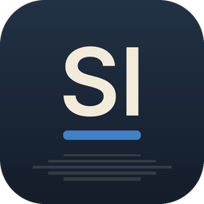

<p align="center">
  
</p>

<h1 align="center">Slides · Suíte FisiLab</h1>

<p align="center"><b>Apresentações</b></p>

<p align="center">Alternativa livre ao <b>Microsoft PowerPoint</b></p>

<p align="center">
  Disponibilizado pelo <b>FisiLab — LARFIC · UFRGS</b> em parceria com o <b>CTA — Centro de
  Tecnologia Acadêmica</b>, para democratizar o acesso à tecnologia entre os alunos da UFRGS.
</p>

---

## O que faz

- **Monta apresentações** com slides mestres e onze layouts com espaços reservados, oito temas
  próprios com esquemas de cores e fontes, seções, anotações, comentários, cabeçalhos e rodapés e
  tamanhos de slide personalizados.
- **Desenha** mais de 150 formas prontas com alças de ajuste, conectores que acompanham as formas,
  ferramentas de forma livre, curva e rabisco, mesclagem de formas, preenchimentos em gradiente,
  imagem e padrão, sombras, brilho e reflexos.
- **Edita texto** diretamente no slide, com formatação completa de fonte e parágrafo, marcadores e
  numeração, colunas, ajuste automático, texto vertical, campos e hiperlinks.
- **Insere conteúdo**: imagens com corte e correções, tabelas com estilos, gráficos, SmartArt básico,
  áudio e vídeo (MP3, AAC, FLAC, Ogg, Opus, WAV; H.264, HEVC, VP9, AV1).
- **Apresenta** com transições (incluindo Morph), animações de entrada, ênfase, saída e trajetória,
  apresentação em tela cheia, modo do apresentador, caneta e ensaio de intervalos.
- **Troca arquivos** com outros programas: abre e salva PowerPoint `.pptx`, exporta PDF (slides,
  páginas de anotações e folhetos com texto selecionável), PNG/JPEG e tópicos em texto. A
  Recuperação Automática guarda o trabalho não salvo.
- **Automatiza**: mais de 200 comandos com desfazer, todos acessíveis pela linha de comando
  (`fisilab-slides-cli`), por um canal de controle JSON e por um servidor MCP para agentes de IA.

## Instalação

### Windows

Baixe o instalador `FisiLab-Slides-Setup-<versão>.exe` na [página de downloads da Suíte FisiLab](https://github.com/mrcandrade/larfic/releases/latest) e execute-o.
O programa aparece no menu Iniciar como **Slides**.

### Compilar a partir do código

É preciso ter o [Rust](https://rustup.rs) instalado (no Windows, com as ferramentas de compilação
do Visual Studio).

```sh
git clone https://github.com/mrcandrade/fisilab-slides
cd fisilab-slides
cargo run --release -p deckcraft                 # abre o Slides (target/release/fisilab-slides)
cargo run --release -p deckcraft-cli -- --help   # a ferramenta de linha de comando (fisilab-slides-cli)
```

No Linux, a compilação também precisa dos cabeçalhos do ALSA (`libasound2-dev` no Debian e Ubuntu,
`alsa-lib-devel` no Fedora). As fontes da interface vêm do
[craft-fonts](https://github.com/storytold/craft-fonts): clone-o ao lado deste repositório
(`../craft-fonts`) ou aponte `CRAFT_FONTS_DIR` para ele; sem ele, o Slides usa as fontes do
sistema.

## Créditos

O Slides é uma versão modificada do **[DeckCraft](https://github.com/storytold/deckcraft)**,
criado pelo ArtCraft Team e pelos contribuidores do DeckCraft, distribuído sob a licença
[MIT](LICENSE-MIT) ou [Apache 2.0](LICENSE-APACHE), à escolha de quem o usa. As modificações do
FisiLab seguem os mesmos termos e estão descritas em [MODIFICACOES.md](MODIFICACOES.md).

Veja também o [NOTICE](NOTICE), a lista de materiais de terceiros em
[ATTRIBUTION.md](ATTRIBUTION.md) e o README original em [README.upstream.md](README.upstream.md).

Os nomes e marcas do projeto original pertencem aos seus titulares; esta versão não é afiliada nem
endossada por eles, nem pela Microsoft.

## Manifesto

Conhecimento produzido em uma universidade pública deve circular livremente, e as ferramentas que
usamos para ensinar, pesquisar e criar também: leia o
[Manifesto pelas tecnologias livres](https://github.com/mrcandrade/larfic/blob/main/suite-fisilab/MANIFESTO.md).

## Privacidade

O Slides não coleta dados de uso nem envia o conteúdo dos seus arquivos para lugar nenhum: não há
telemetria, estatísticas nem verificação automática de atualizações. Veja o que ele guarda no seu
computador e quando usa a internet no [aviso de privacidade da Suíte FisiLab](https://github.com/mrcandrade/larfic/blob/main/suite-fisilab/PRIVACIDADE.md).

---

<p align="center">
  &nbsp;&nbsp;
  <a href="https://cta.if.ufrgs.br"></a>
  &nbsp;&nbsp;
  
</p>

<p align="center"><sub>Suíte FisiLab · FisiLab — LARFIC · UFRGS · em parceria com o CTA — Centro de Tecnologia Acadêmica</sub></p>
